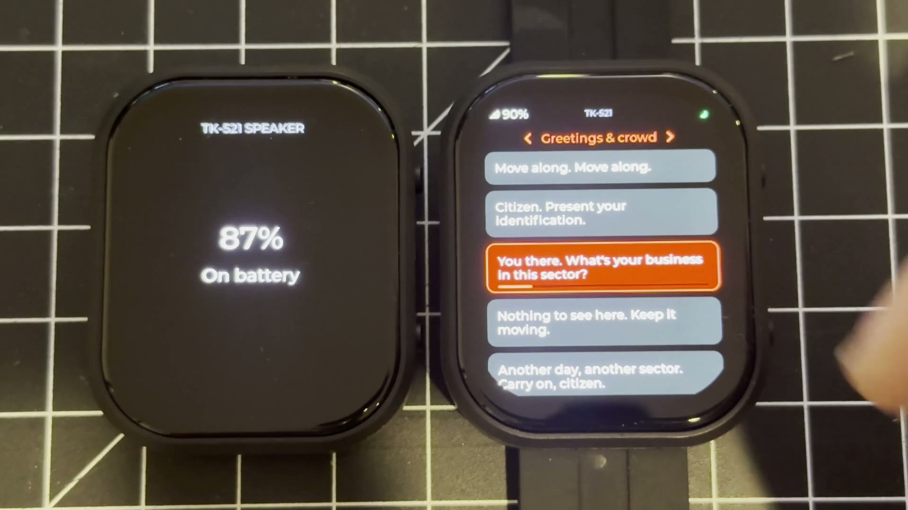
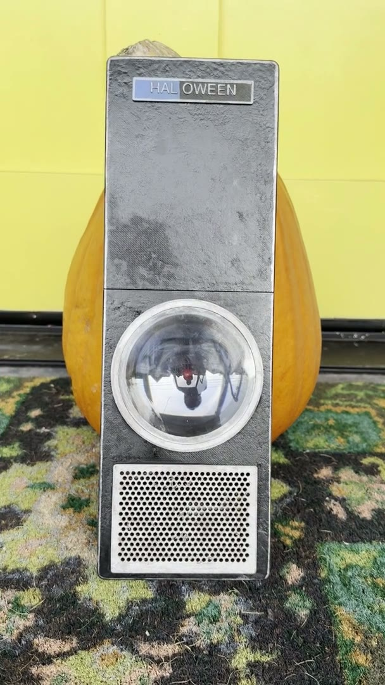
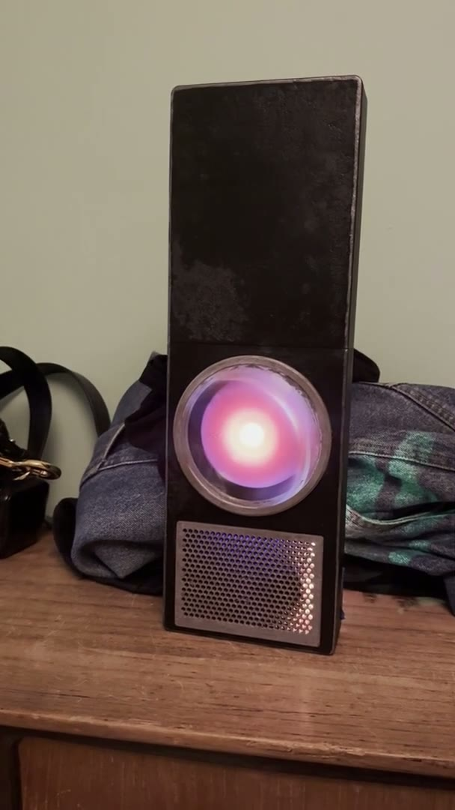
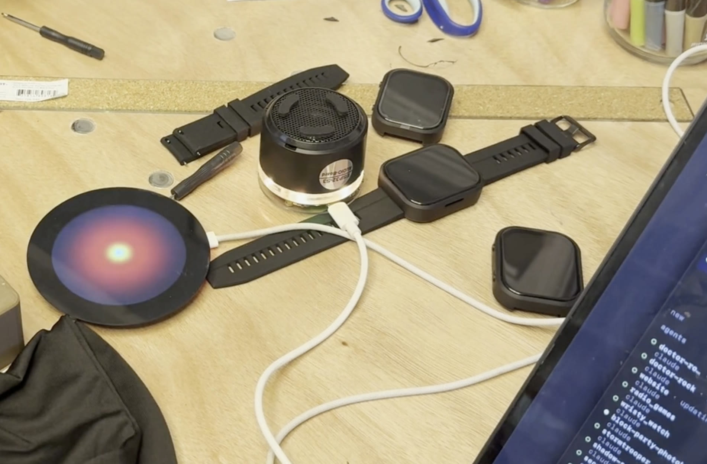

A few Halloween experiments with Waveshare ESP32 boards: a Storm Trooper voice watch, a HAL 9000 that greets trick-or-treaters, and a helmet voice changer.

The hardware:

- [ESP32-S3-Touch-AMOLED-2.06](https://www.waveshare.com/esp32-s3-touch-amoled-2.06.htm) watches
- [ESP32-S3-AUDIO-Board](https://www.waveshare.com/esp32-s3-audio-board.htm) for the speaker (HAL's voice and the voice changer)
- [ESP32-S3-Touch-LCD-2.8C](https://www.waveshare.com/esp32-s3-touch-lcd-2.8c.htm) round display for HAL's eye

Several of the experiments talk board to board over ESP-NOW, which uses the Wi-Fi radio without needing a network. That lets the Storm Trooper watch remote work while trick-or-treating with no hotspot.

  <iframe
    src="https://www.youtube.com/embed/8RWuuIYlBaA"
    title="Halloween 2026 ESP32 Experiments"
    allow="autoplay; fullscreen; picture-in-picture"
    allowfullscreen
    loading="lazy"
  ></iframe>

  
  

