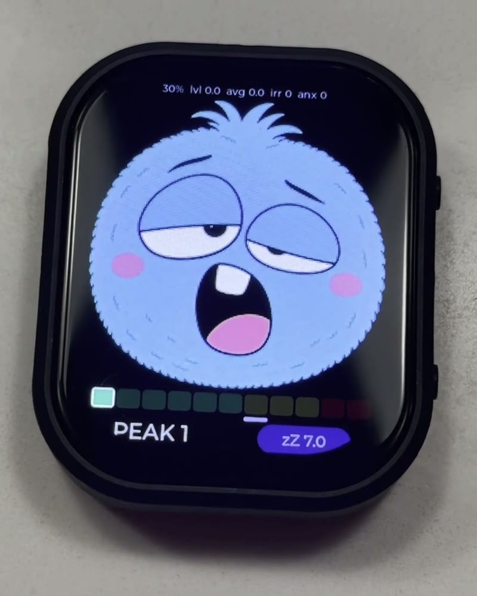
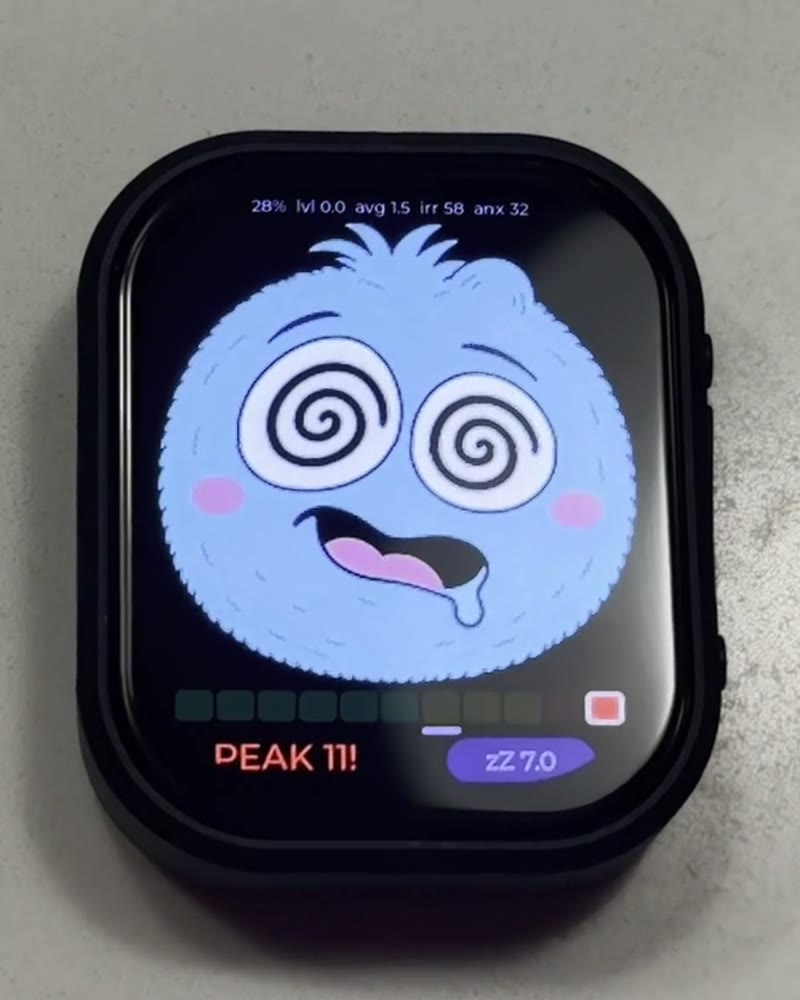
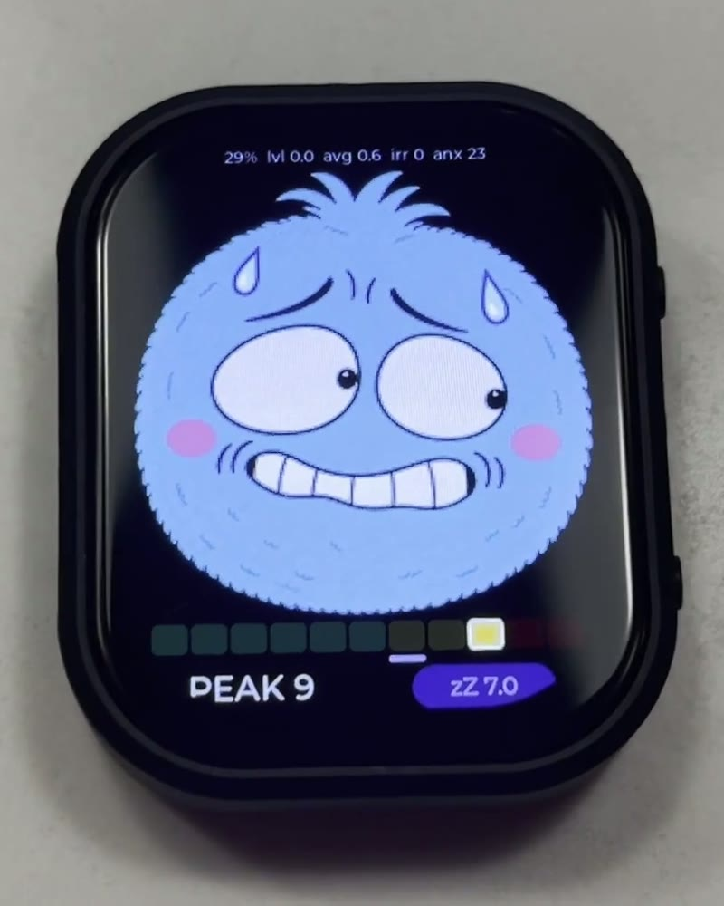

A character that freaks out every time you hit a bump. Encourages smooth driving. Or not.

It runs on a [Waveshare ESP32-S3-Touch-AMOLED-2.06](https://www.waveshare.com/esp32-s3-touch-amoled-2.06.htm) watch. The accelerometer drives the meter under his face.

  <iframe
    src="https://www.youtube.com/embed/_7ilEgM1DCM"
    title="Annoying Road Trip Toy"
    allow="autoplay; fullscreen; picture-in-picture"
    allowfullscreen
    loading="lazy"
  ></iframe>

  
  
  

